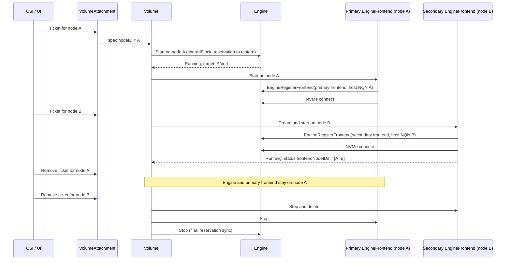
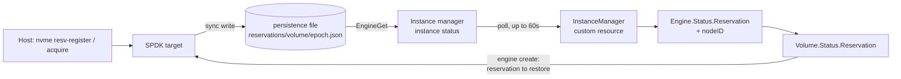
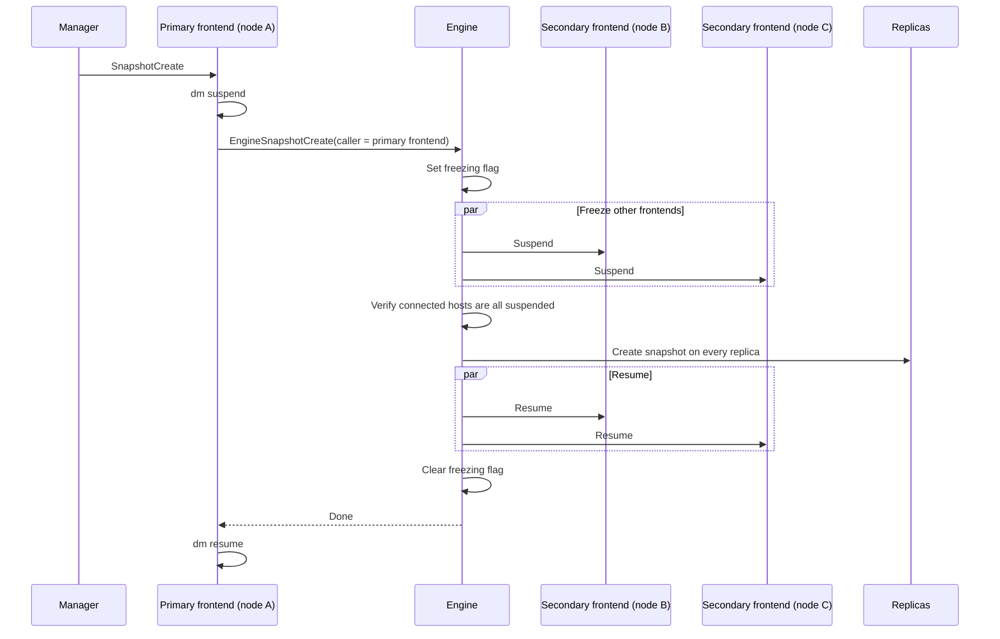
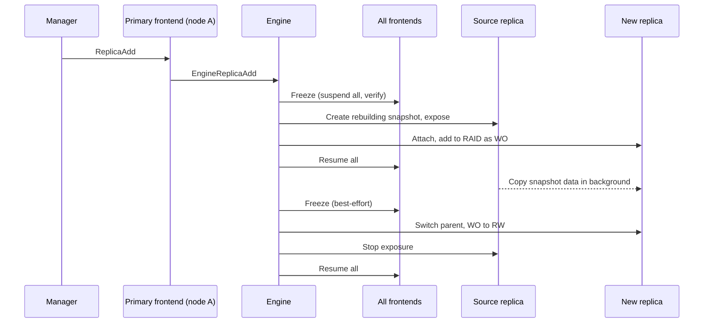
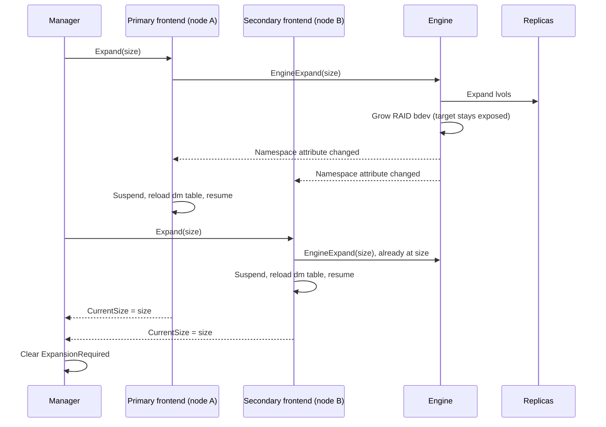

# V2 Shared Block Volume with NVMe Reservation

## Summary

This proposal adds shared block volumes to the v2 data engine. A shared block volume is a `ReadWriteMany` block volume that can be attached to multiple nodes at the same time. All nodes connect to a single engine target through NVMe/TCP, so they see the same data and the same NVMe reservation state.

NVMe Reservation is the NVMe equivalent of SCSI-3 Persistent Reservation. Clustered applications (for example, guest clusters such as Windows Server Failover Clustering, or Linux HA stacks) use it to decide which node may write to a shared disk and to fence a failed node. Longhorn does not issue reservation commands on behalf of applications. Longhorn provides:

- Multi-node read/write access to one v2 volume.
- A single, consistent NVMe reservation state for all attached nodes, served by the SPDK NVMe-oF target.
- Persistence of the reservation state across engine and instance-manager restarts, detach and re-attach, and moving the engine to another node.
- Consistent data operations (snapshot, replica rebuilding, and expansion) while multiple nodes are writing.

Longhorn provides multi-node read/write access; write arbitration among nodes is the application's responsibility via NVMe Reservation.

### Related Issues

- https://github.com/longhorn/longhorn/issues/12055
- https://github.com/longhorn/longhorn/issues/14274

## Motivation

Longhorn has two kinds of `ReadWriteMany` volumes today, and neither of them is a shared block device:

- A regular RWX volume is served by the share-manager over NFS. It supports the `Filesystem` volume mode only, and only one node is attached at the block layer.
- A migratable volume is attached to a second node only during live migration. Each node connects to its own engine, so two targets exist temporarily, and there is only one writer.

Clustered applications need a block device that is attached to all cluster nodes at the same time, with a single reservation state that every node can see. The SPDK NVMe-oF target already implements NVMe Reservation, including persistence through power loss with a `ptpl_file`, but Longhorn does not use it.

### Goals

- Support `ReadWriteMany` block volumes on the v2 data engine that can be attached to multiple nodes at the same time.
- Serve all attached nodes with a single engine target, so that all nodes see one NVMe reservation state.
- Persist the NVMe reservation state across engine and instance-manager restarts, detach and re-attach, and engine node changes. Only deleting the volume clears it.
- Keep replicas consistent when snapshot creation, replica rebuilding, and expansion happen while multiple nodes are writing.
- Report the reservation state in the `Volume` status and warn when the volume is shared without a reservation.
- Support the v2 data paths that do not depend on the number of attached nodes: backup, restore, clone, revert, and disaster recovery volumes.

### Non-goals

- Engine high availability. A shared block volume has exactly one engine. Engine switchover, v2 live migration, and moving the engine during instance-manager live upgrade are not supported for shared block volumes.
- The v1 data engine and SCSI-3 Persistent Reservation.
- Issuing reservation commands (register, acquire, preempt, release, clear) on behalf of applications.
- Coordinating writes among nodes. Applications without NVMe Reservation or a cluster lock manager can corrupt data, the same as with a shared LUN on a SAN.
- Translating SCSI Persistent Reservation in a guest to NVMe Reservation. This belongs to the virtualization layer (for example, Harvester or KubeVirt).
- Encryption, the `ublk` and `nvmf` frontends, sharded volumes, and `strict-local` data locality for shared block volumes.

## Proposal

### User Stories

#### Story 1: Guest cluster on a shared disk

Before this enhancement, a user cannot give one Longhorn volume to several VMs or pods on different nodes as a raw block device. Users of clustered applications need external SAN storage.

After this enhancement, the user creates a v2 volume with `sharedBlock: true` and attaches it to every cluster node. The application registers each node and acquires a reservation through NVMe Reservation. When a node fails, the application preempts the failed node's registration, and the failed node can no longer write.

#### Story 2: Reservation survives maintenance

A user restarts the instance-manager on the engine node, or detaches and re-attaches the volume, possibly to a different set of nodes. The registrations and the reservation holder are still present afterwards, so the application does not lose fencing (fail-open) after maintenance.

#### Story 3: Data protection while shared

A user creates snapshots and backups of a shared block volume, and Longhorn rebuilds a failed replica, while all nodes keep writing. The snapshot is crash-consistent across all replicas, and no node sees I/O errors.

### User Experience In Detail

1. Create a StorageClass with `sharedBlock: "true"`:

    ```yaml
    kind: StorageClass
    apiVersion: storage.k8s.io/v1
    metadata:
      name: longhorn-v2-shared-block
    provisioner: driver.longhorn.io
    allowVolumeExpansion: true
    parameters:
      dataEngine: "v2"
      sharedBlock: "true"
      numberOfReplicas: "3"
    ```

2. Create a PVC with `accessModes: [ReadWriteMany]` and `volumeMode: Block`, and use it from workloads on multiple nodes. Each node gets `/dev/longhorn/<volume>`.

3. Alternatively, create the volume in the UI or API with `Shared Block` checked (v2 only). The UI sets `ReadWriteMany` and the `blockdev` frontend, and disables encryption. The volume can be attached to multiple nodes from the UI; each node uses its own attachment ticket.

4. The application uses `nvme resv-register`, `nvme resv-acquire`, `nvme resv-report`, and so on against the NVMe namespace device (`/dev/nvmeXnY`), or the kernel block persistent reservation ioctls (`IOC_PR_*`). To persist a registration, the host must request it (`--cptpl=3` in `nvme-cli`; the kernel `IOC_PR_REGISTER` path always requests it). See [NVMe Reservation Commands](#nvme-reservation-commands).

5. `kubectl -n longhorn-system get volumes.longhorn.io <volume> -o yaml` shows:
    - `status.frontendNodeIDs`: the nodes the volume is available on.
    - `status.reservation`: the persisted reservation state.
    - The `UnreservedSharedAccess` condition, which is `True` when the volume is available on more than one node and no host holds a reservation.

Requirements and limitations:

- Each node must have a unique NVMe host ID (`/etc/nvme/hostid`). Cloned nodes may share the same DMI product UUID.
- Registrations without persistence requested are lost when the engine restarts.
- A shared block volume supports up to 16 attached nodes.
- When the engine node is drained or its instance-manager is upgraded, the volume is detached from all nodes. Longhorn does not move the engine while the volume is attached.
- If the engine node is permanently lost, reservation changes made after the last sync to the cluster (up to about 60 seconds) are lost.
- Applications that use a distributed lock manager instead of NVMe Reservation (for example, GFS2 or OCFS2) work, but `UnreservedSharedAccess` stays `True`, and they need power fencing.

#### NVMe Reservation Commands

On each attached node, `/dev/longhorn/<volume>` is a device-mapper device on top of the NVMe namespace. `nvme-cli` reservation commands must be sent to the NVMe namespace device:

```shell
# Find the NVMe namespace device (for example, nvme1n1) under /dev/longhorn/<volume>
dmsetup deps -o devname /dev/longhorn/<volume>
```

| Command | Purpose | Main options |
|---------|---------|--------------|
| `nvme resv-register` | Register, unregister, or replace the reservation key of this host | `--nrkey` new key, `--crkey` current key, `--rrega` action (`0` register, `1` unregister, `2` replace), `--cptpl=3` persist the registration through power loss, `--iekey` ignore the current key |
| `nvme resv-acquire` | Acquire the reservation, or preempt another registrant | `--crkey` own key, `--rtype` reservation type, `--racqa` action (`0` acquire, `1` preempt, `2` preempt and abort), `--prkey` key to preempt |
| `nvme resv-release` | Release the reservation, or clear all registrations and the reservation | `--crkey` own key, `--rtype` reservation type, `--rrela` action (`0` release, `1` clear) |
| `nvme resv-report` | Show the reservation status: generation, reservation type, registrants, holder, and keys | `--eds` extended data structure with 128-bit host IDs (required by NVMe-oF), `-o json` |

Reservation types (`--rtype`):

| Value | Type | Who can write | Who can read |
|-------|------|---------------|--------------|
| `1` | Write Exclusive | Holder | All hosts |
| `2` | Exclusive Access | Holder | Holder |
| `3` | Write Exclusive - Registrants Only | Registrants | All hosts |
| `4` | Exclusive Access - Registrants Only | Registrants | Registrants |
| `5` | Write Exclusive - All Registrants | Registrants | All hosts |
| `6` | Exclusive Access - All Registrants | Registrants | Registrants |

Example with two nodes, where node A takes the reservation and node B later fences node A:

```shell
# Node A: register key 0xa1 with persistence, and acquire Write Exclusive
nvme resv-register /dev/nvme1n1 --namespace-id=1 --nrkey=0xa1 --rrega=0 --cptpl=3
nvme resv-acquire  /dev/nvme1n1 --namespace-id=1 --crkey=0xa1 --rtype=1 --racqa=0

# Node B: register key 0xb1; writes from node B now fail with Reservation Conflict
nvme resv-register /dev/nvme1n1 --namespace-id=1 --nrkey=0xb1 --rrega=0 --cptpl=3

# Any node: show the holder, the reservation type, and the registrants
nvme resv-report /dev/nvme1n1 --namespace-id=1 --eds -o json

# Node B: preempt node A (removes the registration of node A and takes the reservation)
nvme resv-acquire  /dev/nvme1n1 --namespace-id=1 --crkey=0xb1 --prkey=0xa1 --rtype=1 --racqa=1

# Node B: release the reservation, and unregister
nvme resv-release  /dev/nvme1n1 --namespace-id=1 --crkey=0xb1 --rtype=1 --rrela=0
nvme resv-register /dev/nvme1n1 --namespace-id=1 --crkey=0xb1 --rrega=1

# Any registrant: clear all registrations and the reservation
nvme resv-release  /dev/nvme1n1 --namespace-id=1 --crkey=<key> --rrela=1
```

The NVMe namespace device name can differ between nodes. The state is the same on every node, because all nodes connect to the same engine.

### API Changes

#### Volume CRD

```go
type VolumeSpec struct {
    // sharedBlock allows the RWX block volume to be attached to multiple nodes
    // at the same time. Only supported by the v2 data engine. Immutable.
    SharedBlock bool `json:"sharedBlock"`
}

type VolumeStatus struct {
    // frontendNodeIDs lists the nodes with a running engine frontend.
    FrontendNodeIDs []string `json:"frontendNodeIDs"`
    // reservation is the persisted NVMe reservation state.
    Reservation *VolumeReservation `json:"reservation"`
}

type VolumeReservation struct {
    Epoch        int64                         `json:"epoch"`  // increases when the engine moves to another node
    NodeID       string                        `json:"nodeID"` // engine node of this epoch
    Final        bool                          `json:"final"`  // synced when the engine stopped
    Type         int                           `json:"type"`   // 1 to 6, or 0 if no reservation
    HolderKey    string                        `json:"holderKey"`
    HolderHostID string                        `json:"holderHostID"`
    Registrants  []VolumeReservationRegistrant `json:"registrants"`
}
```

- New volume condition `UnreservedSharedAccess` (reason `NoReservation`).
- New volume event `ReservationRestoredFromCluster`.
- `Engine.Status.Reservation` and `InstanceManager.Status.InstanceEngines[].Status.Reservation` carry the state reported by the engine.

Webhook rules for `spec.sharedBlock: true`:

| Field | Rule |
| --- | --- |
| `dataEngine` | Must be `v2` |
| `accessMode` | Must be `rwx` |
| `frontend` | Must be `blockdev` (empty is allowed for standby volumes) |
| `encrypted` | Must be `false` |
| `dataLocality` | Must not be `strict-local` |
| `dataLayout` | Must not be sharded |
| `migratable` | Allowed, ignored. The engine never live-migrates. |

#### Instance manager and SPDK gRPC

- `shared_block` is added to the engine and engine frontend create requests and to the instance spec.
- `ReservationState` is added to the engine create request (the state to restore) and to the engine status (the state the target persists).
- `EngineRegisterFrontend` registers an engine frontend with the engine so the engine can suspend all frontends.
- `SnapshotRequest.engine_frontend_name` tells the engine which frontend initiated a snapshot and is already suspended.

## Design

### Implementation Overview

#### High-Level View

Every attached node is an NVMe/TCP initiator that connects to the same NVMe-oF target in the single engine. The target keeps one namespace and one reservation state for all nodes.

```text
+-----------+   +-----------+   +-----------+
|  Node A   |   |  Node B   |   |  Node C   |
| initiator |   | initiator |   | initiator |
+-----+-----+   +-----+-----+   +-----+-----+
      |               |               |
      +----------- NVMe/TCP ----------+
                      |
                      v
         +-------------------------+
         | Engine (NVMe-oF target) |
         | one namespace           |
         | NVMe reservation        |
         +------------+------------+
                      |
                      v
                  Replicas
```

#### Object Model

A shared block volume has one `Engine` and one `EngineFrontend` per attached node:

- The primary `EngineFrontend` `<volume>-ef-0` is `Active` and runs on the engine node. It is the frontend that initiates snapshot creation and replica rebuilding, like the single frontend of a regular v2 volume.
- A secondary `EngineFrontend` `<volume>-ef-shared-<node hash>` (`Active=false`) runs on every other attached node.

```text
                          +-----------------------------+
                          |            Volume           |
                          |-----------------------------|
                          | spec.sharedBlock = true     |
                          | status.frontendNodeIDs      |
                          | status.reservation (epoch)  |
                          +--------------+--------------+
                                         |
            +----------------------------+----------------------------+
            |                            |                            |
            v                            v                            v
+------------------------+   +------------------------+   +------------------------+
| EngineFrontend         |   | EngineFrontend         |   | EngineFrontend         |
| <volume>-ef-0          |   | <volume>-ef-shared-x   |   | <volume>-ef-shared-y   |
| node A (primary)       |   | node B (secondary)     |   | node C (secondary)     |
| /dev/longhorn/<volume> |   | /dev/longhorn/<volume> |   | /dev/longhorn/<volume> |
+-----------+------------+   +-----------+------------+   +-----------+------------+
            | NVMe/TCP (host NQN A)      | NVMe/TCP (host NQN B)      | NVMe/TCP (host NQN C)
            +----------------------------+----------------------------+
                                         |
                                         v
                         +-------------------------------+
                         | Engine (node A)               |
                         |-------------------------------|
                         | one NVMe-oF subsystem         |
                         | one namespace                 |
                         | 16 controller IDs             |
                         | NVMe reservation              |
                         | persistence file (ptpl_file)  |
                         | registered frontends          |
                         +---------------+---------------+
                                         |
                                         v  RAID1
           +----------------+   +----------------+   +----------------+
           |   Replica 1    |   |   Replica 2    |   |   Replica 3    |
           +----------------+   +----------------+   +----------------+
```

All I/O from all nodes goes through the single engine, so there is one ordering point for writes and one reservation state. Each node keeps its own device-mapper device on top of the NVMe namespace, as with RWO v2 volumes, so I/O can be queued on each node by `dm suspend`.

#### Attach and Detach

The desired set of frontend nodes comes from the `VolumeAttachment` tickets. No new attach API is added: CSI and the UI use the existing attach and detach APIs, and the UI uses one attachment ID per node (`longhorn-ui-<node>`) for shared block volumes.

- The engine node is the node of the first ticket (`Volume.Spec.NodeID`). The engine and the primary frontend stay on this node while any ticket exists, even if the ticket of this node is removed.
- `reconcileSharedBlockEngineFrontends` creates and deletes secondary frontends to match the workload tickets on other nodes. It does not create new secondary frontends while the frontend is disabled (maintenance, restore, clone) or while expansion is in progress.
- The volume is fully detached when the last ticket is removed. Detach order is the same as v2 RWO: frontends, then the engine, then replicas.



#### NVMe Target Configuration

- One NVMe-oF subsystem and one namespace per engine, as with RWO v2 volumes. NQN, NGUID, and namespace UUID are derived from the volume name.
- A shared block engine allows a range of 16 controller IDs, derived from the target address, instead of a single one. Each connected host gets its own controller.
- The registrant identity is the NVMe host ID, so every node must have a unique host ID.
- The namespace is added with a `ptpl_file`, so SPDK persists the reservation state on every change before it completes the command.

#### Reservation Persistence

SPDK writes the reservation state to the `ptpl_file` synchronously, which gives the persistence semantics NVMe requires. The file alone is not enough, because it lives on the engine node, and the engine may run on a different node after re-attach. So the state is kept at two levels:

- **Local persistence file**: `<metadataDir>/reservations/<volume>/<epoch>.json` on the engine node. It is the most recent state for the current epoch.
- **`Volume.Status.Reservation`**: the cluster-wide source of truth, used to restore the state on another node or when the local file is missing or corrupted.

The epoch identifies a generation of the state. It increases when the engine starts on a node different from the node of the last known state.



When the engine is created:

1. The engine controller picks the newer of `Volume.Status.Reservation` and `Engine.Status.Reservation`. If the engine node equals its `nodeID`, the epoch is kept; otherwise the epoch is increased by one.
2. The spdk-engine keeps a valid local persistence file of the same epoch, because it is never older than the cluster state (for example, after an instance-manager crash). Otherwise it writes the file from the state passed by the manager. Files of other epochs are removed.
3. The namespace is added with the persistence file, and SPDK restores the registrations and the reservation before accepting I/O.

When the volume is detached normally, the engine controller reads the state once more before deleting the engine and marks it `final`. If the engine moves to another node and the previous state is not `final`, the volume records a `ReservationRestoredFromCluster` warning event: the restored state may miss changes from the last seconds before the previous engine node failed. Restoring a slightly old state is still safer than starting with no reservation.

The state is cleared only when the volume is deleted.

#### Consistent Data Operations Across Frontends

For an RWO v2 volume, the single frontend suspends its device-mapper device during snapshot creation and replica rebuilding, so no I/O is in flight while the replicas are changed. For a shared block volume, the other nodes would keep writing, and the replicas could be snapshotted at different I/O points.

The engine therefore coordinates all frontends. This is called a freeze:

- **Frontend registry**: each shared block frontend registers `{name, address, hostNQN}` with the engine before connecting, and re-registers every 30 seconds so the registry is rebuilt after an engine restart.
- **Freeze**: the engine suspends all registered frontends in parallel (`dm suspend`), without holding the engine lock. Frontend I/O is queued in device-mapper on each node. The NVMe connections, including keep-alive, are not affected, so there is no timeout during a long operation.
- **Verification**: the engine checks that every host connected to the subsystem (`nvmf_subsystem_get_controllers`) belongs to a suspended frontend. Otherwise, it resumes the suspended frontends and fails the operation. The manager retries.
- **Exclusion**: snapshot creation, replica add, and frontend registration share one freezing flag. A second operation fails immediately instead of waiting, which avoids deadlocks between the engine and frontends. New frontends cannot connect during a freeze.
- **Resume**: all frontends are resumed when the operation finishes or fails.

The SPDK subsystem pause and RAID bdev quiesce were considered and rejected. Subsystem pause also queues admin commands, so hosts reconnect after the 5-second keep-alive timeout and fail I/O after the fast I/O fail timeout. RAID quiesce is used internally by SPDK RAID operations and can deadlock with them.

##### Snapshot Creation

Snapshot creation is sent only to the primary frontend, as with RWO volumes.



##### Replica Rebuilding

Replica rebuilding adds a new replica to the RAID1 bdev and copies data from a healthy replica. The synchronous part of `ReplicaAdd` (creating the rebuilding snapshot, exposing the source, attaching the new replica, and growing the RAID with the new replica in `WO` mode) runs inside a freeze of all frontends. After the data is copied in the background, the finishing part (switching the snapshot parent, stopping the exposure, and changing the replica from `WO` to `RW`) runs inside another freeze. As in the RWO flow, the finishing freeze is best-effort.



##### Expansion

Expansion does not need a freeze. The engine grows the RAID bdev in place, and the target and the NVMe connections stay up. Unlike a snapshot, expansion does not capture a point in time across the replicas: all writes from all nodes go through the same RAID1 bdev to every replica, data within the old size is not changed, and the new space cannot be used until the RAID bdev has grown. This is the same as for an RWO v2 volume, whose host also keeps writing during expansion.

1. The manager requests expansion through every ready frontend.
2. The first `EngineExpand` expands the replicas and grows the RAID bdev. Later calls find the engine at the new size and return.
3. SPDK sends a namespace attribute changed notice to every connected controller, so the kernel on each node updates the size of the NVMe namespace.
4. Each frontend suspends its own device-mapper device, reloads the table with the new size, and resumes it.
5. The manager clears `ExpansionRequired` only after every ready frontend reports the new size (`isEngineFrontendServingVolumeSize`). New secondary frontends are not created during expansion, so a node that attaches during expansion waits until it finishes.



The hosts stay connected, so registrations without persistence are kept. Until a node reloads its device-mapper table, it still sees the old size. When to use the new space is up to the application, the same as when a shared LUN on a SAN is expanded.

#### Other Operations

| Operation | Behavior |
| --- | --- |
| Backup | Uses a snapshot created through the freeze. The backup reads the snapshot from replicas only. |
| Clone from a shared block volume | The source snapshot is created through the freeze. |
| Clone to, restore to, and revert a shared block volume | Run with the frontend disabled, so no host is connected, same as RWO. Secondary frontends are created after the volume is attached for workloads again. |
| Disaster recovery volume (standby) | Supported. Incremental restore runs with the frontend disabled. After activation, the volume can be attached to multiple nodes. |
| Engine switchover, v2 live migration, instance-manager live upgrade | Not supported. A shared block volume always has one engine. |

#### Monitoring

- `status.frontendNodeIDs` lists the nodes with a running frontend.
- `status.reservation` shows the persisted reservation state, synced from the engine within about 60 seconds.
- `UnreservedSharedAccess` is `True`, and a warning event is recorded once, when the volume is available on more than one node and no host holds a reservation. Longhorn only reports this; it does not block I/O from unregistered hosts. NVMe defines that all hosts may access the namespace when there is no reservation, and applications such as WSFC register and acquire before they write.

### Test Plan

Unit tests:

- spdk-engine: controller ID range, persistence file encoding and parsing, epoch file selection, frontend registry, freeze success and failure paths, and snapshot creation with and without a suspended caller.
- manager: webhook validation, attach and detach decisions, secondary frontend reconciliation, epoch calculation, reservation sync, and the `UnreservedSharedAccess` condition.

Integration tests (multiple nodes, v2 data engine):

1. Attach a shared block volume to two nodes, write on one node with `O_DIRECT`, and verify the data on the other node.
2. Reservation: register both hosts, acquire Write Exclusive, verify that the other host can read but its writes fail with Reservation Conflict, preempt, release, and repeat with Write Exclusive - All Registrants.
3. Verify that `Volume.Status.Reservation` reflects the state, and `UnreservedSharedAccess` changes after acquire and release.
4. Restart the instance-manager on the engine node and verify that the volume recovers, the registrations and the holder are restored, and the data is unchanged.
5. Detach from all nodes and re-attach on a different engine node. Verify that the epoch increases and the reservation is restored.
6. Create snapshots and rebuild a replica while both nodes write continuously. Verify that every frontend is suspended and resumed, there are no I/O errors, and the replicas are consistent.
7. Expand the volume while both nodes write. Verify the new size on every node and that the reservation is unchanged.
8. Backup, restore to a shared block volume and to a regular volume, clone, revert, and disaster recovery volume activation. Verify the data.
9. Webhook rejections: v1, RWO, encrypted, non-blockdev frontend, and changing `sharedBlock`.
10. Partial detach: remove the ticket of the engine node or a secondary node, and verify that the remaining nodes keep working.
11. Run the blktests NVMe reservation test (`nvme/054`) against a shared block volume target.

### Upgrade strategy

- `spec.sharedBlock` defaults to `false`, so existing volumes are not affected.
- The new CRD fields are optional and require the updated CRDs to be installed.
- Shared block volumes require the engine, instance-manager, and manager from the same release. The instance-manager on the engine node must not be live-upgraded while a shared block volume is attached; detach the volume first.

## Note

### Known Limitations

- No engine HA. When the engine node fails or is drained, the volume becomes unavailable on all nodes until the engine runs again. Engine relocation and fast failover are tracked separately.
- A host that registers without persistence loses its registration when the engine restarts.
- The reservation state of a permanently lost engine node may miss up to about 60 seconds of changes.
- Orphaned persistence files may remain under `<metadataDir>/reservations/<volume>/` on old engine nodes after the volume is deleted.
- If the engine restarts, a freeze fails until all frontends register again (up to 30 seconds), and the manager retries.
